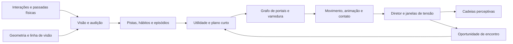

# Inteligência Hostil · Relatório técnico

## Diagnóstico da dev.5

Foram reproduzidos dois caminhos para a desistência após um desvio. Na caminhada, o destino de aproximação ficava preso à referência inicial. Ao mirar um centro da grade, o tronco virava e a cabeça parava de acompanhar o alvo. Na caçada, a busca exigia um destino com espaço para a postura inteira. O operador podia passar rente a um equipamento e continuar visível, enquanto a rota ficava vazia e encerrava com `End::Route`. Os dois testes foram executados na dev.5 antes da correção e voltaram a passar após o ajuste.

O ensaio com equipamento também mostrou por que validar arcos da grade difere de validar uma rotação. A malha de navegação contém passagens suficientes para o quadrúpede alinhado, mas a envoltória cresce quando ele vira. O custo de navegação agora prefere arestas com folga de giro. Os atalhos e cada avanço continuam sujeitos à varredura com a envoltória orientada.

## Componentes em execução

| Arquivo | Papel |
|---|---|
| `src/lab/observer/brain.rs` | Ciclo lógico a 60 Hz, percepção, comprometimento, utilidade e execução em pé |
| `src/lab/observer/cognition.rs` | Pistas temporárias, deslocamento observado, 12 memórias episódicas e 12 registros de travessia |
| `src/lab/observer/tactics.rs` | Planos de até quatro etapas e interceptação por evidência recente |
| `src/lab/observer/nav.rs` e `hunt.rs` | A* com buffers reutilizados e limite de nós, replanejamento, busca quadrúpede e contato físico |
| `src/atmosphere/director.rs` e `sound/choreography.rs` | Arbitragem de janelas, pressão, fases, escolha e recuperação das cadeias sonoras |
| `src/lab/observer/scenario.rs` | Bots simples, cenários sem renderização e relatório da matriz por seed |

## Percepção, decisões e memória

- O centro visual exige exposição e raio livre. Na periferia o alcance é menor, o acúmulo é mais lento e movimento sustentado ou proximidade ajudam a reconhecer o alvo. Perder o raio interrompe novas observações. A atenção do jogador influencia a decisão somente durante contato visual confirmado.
- O sensor de som recebe passadas e interações físicas. Distância, portas, portais e obstáculos pesam na confiança. A posição auditiva é aproximada. Sons da Presença e pedidos da apresentação ilusória ficam na camada de áudio. O diretor usa o setor do operador para compor a experiência. A criatura recebe uma oportunidade de encontro e forma conhecimento com seus próprios sensores.
- As pistas decaem com a idade. O cérebro pode usar visão confirmada, ruído recente, último ponto visto ou uma região com incerteza. A velocidade vem de observações visuais consecutivas. Um indício forte pode interromper uma espera, e a investigação recebe compromisso suficiente para mover, escutar e verificar uma conexão.
- Travessias consecutivas observadas podem aumentar o peso de uma passagem. Um testemunho isolado ainda vale como pista, mas o peso habitual só cresce com repetição. Reveses e idade diminuem o peso. As estimativas de movimento afetam a escolha entre observar e intimidar. O limite de velocidade permanece o mesmo para todas as rotas.
- Ao perder visão numa corrida, a entidade segue brevemente o último indício e pode reduzir o ritmo para buscar. Busca por setores e interceptação usam saídas ligadas e geometria existente. Uma interceptação requer direção observada, tempo plausível e margem em torno da passagem. A Presença retoma a corrida ao confirmar o jogador e preserva o orçamento acumulado da caçada.
- O contato usa uma varredura ao longo do movimento aceito, alcance, orientação e raio livre. Contato e pista perdida têm resultados independentes. Refúgios, a elegibilidade de captura, a sanidade e o posto de Despertar seguem a sessão da campanha. O Lab mantém uma sessão própria.

## Ritmo e contrajogo

A caçada ativa reserva a intensidade do diretor. O cérebro determina a execução e pode parar ao alcançar refúgio, perder pista ou esgotar seu tempo de esforço. Um evento sonoro pode preparar, emitir uma pista, escutar a reação e desenvolver a sequência ou deixá-la morrer. A escolha pondera condição do setor, familiaridade, movimento, instabilidade e repetição recente. A recuperação reserva um intervalo próprio.

A reação registra mudanças observáveis como aproximar-se, virar, acelerar ou mudar de setor quando o evento tem alcance plausível. O registro reduz a repetição de padrões pouco eficazes e pode liberar uma oportunidade posterior de alteração familiar. Em condições estreitas, uma manifestação sonora de desvio ocorre num setor distinto da criatura que está investigando discretamente.

O relé oferece um estalo depois de 1,45 s e rearma em 24 s. Andar agachado reduz o alcance da passada. Obstáculos cortam percepção e corredores com alternativas dão espaço para mudar de posição antes de ser visto. A hipótese pode estar errada e é possível esperar a criatura passar.

## Limites da edição experimental

O movimento usa as animações existentes e a grade de piso da Estação 07. A busca é curta e a interceptação usa conexões próximas, com replanejamento síncrono limitado. Portas e equipamentos são tratados pelos volumes do mapa. O planejamento durante uma perseguição se desloca integralmente pela geometria. Uma nova manifestação pode surgir em âncora fora do olhar depois que o encontro anterior termina e o diretor abre outra oportunidade. A coordenação audiovisual se restringe a janelas de tempo e separação de setores. O Lab exibe o estado congelado do diretor da campanha enquanto simula seu próprio ator. A matriz confirma comportamentos em condições controladas. A legibilidade da Presença, o medo e a justiça percebida precisam de sessões humanas. [Referências](REFERENCIAS-IA-v0.0.12-dev.6.md) · [Validação](VALIDACAO-v0.0.12-dev.6.md)
