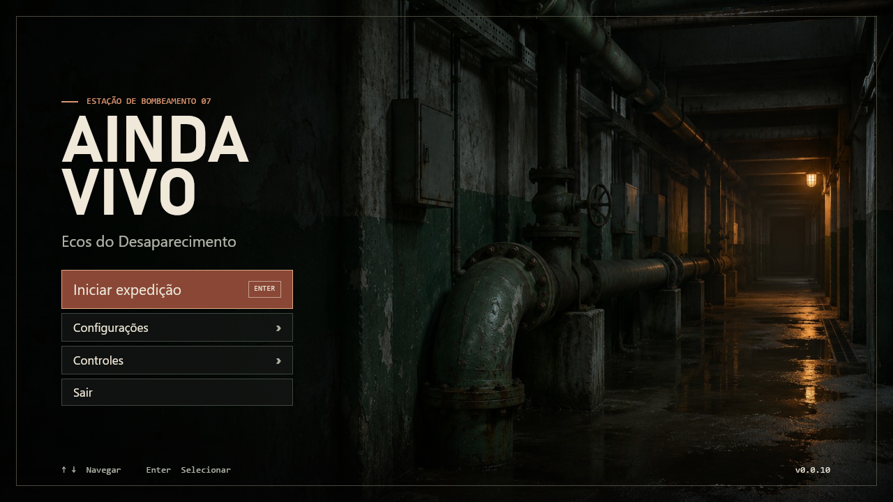

# Abertura da v0.0.10

A nova abertura usa um corredor úmido de serviço da Estação 07, com luz de manutenção âmbar e tipografia de alto contraste. A tela apresenta **Iniciar expedição**, **Configurações**, **Controles** e **Sair**. A arte é estática e a interface pode ser operada com mouse, setas ou Tab. Enter aciona o item em foco. Esc volta de um painel e pausa ou retoma a vistoria.



As configurações reúnem campo de visão, sensibilidade, balanço, VHS, VSync e som ambiente. Os controles exibidos leem os atalhos locais. A pausa e a tela de fim usam o mesmo estilo sobre o ponto atual da estação. Despertar mantém a confirmação e o foco começa em **Voltar**.

## Implementação

A interface `src/ui/menu` é nativa do Bevy. A navegação fica em um recurso separado da sessão, e as ações de jogo continuam chamando as regras de `app.rs`. A arte em JPEG entra no executável e é decodificada uma vez com `zune-jpeg`. As fontes vêm do Windows, com fallback do Bevy. Na tela inicial, a câmera renderiza a interface com as camadas da cena 3D desativadas. Ao iniciar a vistoria, as camadas voltam ao estado de jogo.

## Distribuição

O pacote da revisão continua identificando o jogo como **v0.0.10**. Ele fica junto da edição original na mesma página da release. A nota da revisão associa o pacote ao commit que o compilou. [ZIP com o menu renovado](https://github.com/mgueoss/ainda-vivo/releases/download/v0.0.10/ainda-vivo-v0.0.10-windows-x64-menu.zip) · [Release v0.0.10](https://github.com/mgueoss/ainda-vivo/releases/tag/v0.0.10)

## Validação

- Rustfmt, Clippy e 46 testes Rust passaram com o cache local.
- O smoke nativo do menu verificou foco, setas, Tab, Enter, Esc, ações de botão, campo de visão, volume, retorno da confirmação e retomada do posto. Foram geradas cinco capturas, com a abertura em 1280 × 720 e em 640 × 480. [Relatório do smoke](smoke-v0.0.10-menu.txt)
- A vistoria completa passou em 12.260 quadros de teste, com renderização Vulkan e reprodução dos incidentes sonoros.
- O ZIP contém a build validada e abriu pelo botão **JOGAR** do inicializador universal no Windows x64. O teste também bloqueou um pacote sem executável.

| Arquivo | SHA-256 |
|---|---|
| `ainda-vivo-v0.0.10-windows-x64-menu.zip` | `00df7ceae3d441dc134d2975657cecbf1d189ea83d57ed65d99baf02c031d9c2` |
| `game/ainda-vivo.exe` | `bead190b3cf15040a9d7ab82b0bc13b38fa98659b5b3e42081c442fd39a5f3c7` |

## Arte

O [fundo do menu](../assets/menu/estacao-07.jpg) foi criado com a ferramenta integrada de geração de imagens, depois convertido para JPEG para distribuição. Os elementos de interface são desenhados pelo jogo.

<details>
<summary>Brief de geração da arte</summary>

```text
Use case: photorealistic-natural
Asset type: widescreen 16:9 backdrop for the main menu of AINDA VIVO, a quiet Brazilian psychological horror game.
An abandoned service corridor under a small Brazilian municipal pumping station at night, seen from human eye level. A convincing real industrial place: worn green-grey painted concrete, heavy old water pipes and flanges, hanging numbered-looking blank breaker boxes, humid air, a shallow wet floor. Cinematic photography, restrained 35mm grain, believable roughness. A single rusty amber service light far down the right side of the corridor casts a muted reflection in the water. Deep cool grey and petrol-green shadows still retain surface detail. The distant end of the hall feels unexplained and empty.
Put the pipework, visual depth and amber-lit vanishing point in the RIGHT two thirds, vanishing point about 72% from the left. The LEFT 36% is quiet, very dark foreground wall and shadow with no bright objects; this negative space will carry game title and interactive menu drawn separately. Keep the bright elements away from the far right frame edge and lower 7%. Emphasize tangible near-to-far architectural depth, an uneasy ordinary industrial environment. Output the finished backdrop only. No figures, bodies, blood, interface, text, numbers, symbols, borders, tape overlays, hard flares or watermarks.
```

</details>
